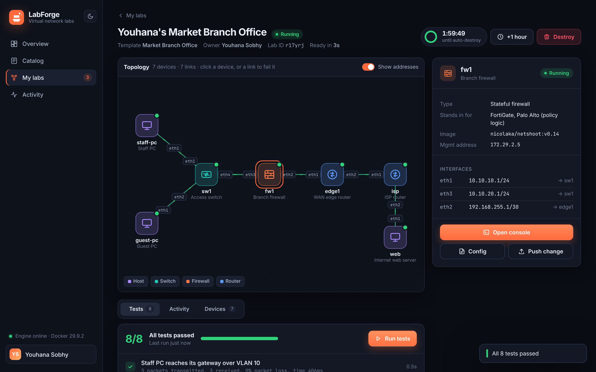

# LabForge

**On-demand virtual network labs.** Pick a topology, get a working network of routers, switches,
firewalls and hosts in about two seconds, test your change against it, and let it destroy itself
when its time is up. Nothing touches production and nobody waits for a shared lab rack.



## Why

Physical labs are scarce, shared and out of date, so most network changes are tested in production or
not at all. LabForge gives every engineer a private, realistic copy of the network on demand:

- **Launch in seconds** from a catalog of ready-made topologies (branch office, WAN, data-centre fabric,
  firewall zones, a training lab).
- **Prove it works.** Every topology ships with built-in tests (reachability, BGP and OSPF state,
  routes, must-be-blocked flows). Run them before and after a change and the result is evidence.
- **Break things safely.** Push config to any device, open its console in the browser, or fail a link
  with one click and watch the network reroute.
- **Cleans up after itself.** Every lab has a lifetime and is destroyed automatically, so capacity is
  never stuck on forgotten labs.
- **Same labs in CI.** `labforge test` boots each topology, runs its tests and tears it down, so every
  change to a topology or config is tested before review.
- **Measured.** The dashboard tracks labs launched, engineers served, device-hours delivered, time to
  ready and test pass rate.

## The four device targets

All four run from open, freely pullable images, so the MVP needs no licences.

| Target | What it runs | Stands in for |
| --- | --- | --- |
| **Router** | FRRouting (BGP, OSPF, BFD, static) with an industry-standard CLI (`vtysh`) | Cisco IOS-XR / NX-OS, Juniper routing |
| **Switch** | 802.1Q VLAN switch: access and trunk ports, MAC learning, SVIs | Nexus access/leaf, campus switches |
| **Firewall** | Zone-based stateful firewall (nftables) with policy push and validation | FortiGate, Palo Alto (policy logic) |
| **Host** | Linux endpoint with ping, traceroute, curl, iperf3, tcpdump | Servers, VMs, user PCs |

Vendor images (Cisco Nexus 9000v, Juniper vJunos/cRPD, FortiGate VM, PAN-OS VM, Arista cEOS, Nokia
SR Linux, the ACI simulator, nested vSphere) plug in through the same driver interface in
[`labforge/kinds.py`](labforge/kinds.py) once licensed images are in a registry. Arista cEOS and
Nokia SR Linux are free; the rest need vendor licences.

## The catalog

| Template | Devices | Tests | What it is for |
| --- | --- | --- | --- |
| Routing Starter Lab | 4 | 3 | Training: two routers running OSPF, two PCs |
| Three-Zone Firewall Policy | 4 | 6 | Inside / DMZ / Outside, prove a policy change opens only what it should |
| Market Branch Office | 7 | 8 | Staff and Guest VLANs, firewall, eBGP edge router to an ISP |
| WAN BGP Triangle | 6 | 7 | Three AS full mesh; fail a link and watch traffic reroute |
| Data Centre Leaf-Spine Fabric | 8 | 7 | Two spines, two leaves, OSPF ECMP underlay, ToR switch |

Templates are YAML files in [`labforge/catalog/`](labforge/catalog). Add your own from the UI
(**Catalog → Add topology**) or by dropping a file into `~/.labforge/catalog/`. Check one first with
`labforge validate my-lab.yaml`.

## Quick start

You need Docker (Docker Desktop on Windows or macOS, or Docker Engine on Linux).

### Option A: run it in Docker (recommended)

```bash
docker compose up -d --build
```

Open <http://localhost:8080>. On Windows the same command works in PowerShell, or run
`scripts\start.ps1`, which also opens the browser.

### Option B: run it with Python

```bash
pip install -e ".[dev]"
labforge serve            # http://localhost:8080
```

On Linux, run as a user that can reach the Docker socket.

The first launch of each device type pulls its image (`frrouting/frr:v8.4.1`, `nicolaka/netshoot:v0.14`,
about 300 MB in total). After that, labs boot in 1 to 3 seconds.

## Command line

```bash
labforge catalog                       # list templates
labforge up branch-office --ttl 60     # launch a lab and wait until it is ready
labforge ls                            # active labs and time left
labforge check <lab-id>                # run the lab's tests
labforge exec <lab-id> edge1 "show ip bgp summary"
labforge extend <lab-id> --minutes 60
labforge down <lab-id>
labforge test                          # CI mode: launch, test and destroy every template
labforge stats                         # usage KPIs
```

## How it works

```
 Browser UI ──► FastAPI (labforge.api) ──► LabManager ──► Engine ──► Docker API
                    │                         │                         │
              WebSocket console          SQLite store            one container per device,
                                    (labs, events, tests)      one network per link
                                    reaper thread: auto-expiry
```

- Each device is a container and each link is its own Docker bridge network, so interfaces inside the
  device are named exactly as in the topology (`eth1`, `eth2`, ...). Only the Docker API is used: no
  host root, no extra tools.
- Devices are configured at boot from the template (interface addresses, FRR config, switch VLANs,
  firewall ruleset) and again whenever you push a change.
- A background reaper destroys labs when their lifetime ends. On restart, LabForge cleans up anything
  half-built and removes containers that no lab owns.
- Everything is recorded in SQLite (`~/.labforge/labforge.db`), which drives the activity feed and
  the KPI dashboard.

## Configuration

| Variable | Default | Meaning |
| --- | --- | --- |
| `LABFORGE_HOME` | `~/.labforge` | Database and custom templates |
| `LABFORGE_MAX_ACTIVE_LABS` | `10` | Capacity limit across all users |
| `LABFORGE_MAX_TTL_MINUTES` | `480` | Longest a lab may live, including extensions |
| `LABFORGE_REAP_INTERVAL_SECONDS` | `10` | How often expiry is checked |
| `LABFORGE_IMAGE_FRR` | `frrouting/frr:v8.4.1` | Router image (newer FRR builds work too) |
| `LABFORGE_IMAGE_LINUX` | `nicolaka/netshoot:v0.14` | Image for switch, firewall and host |
| `LABFORGE_LINK_POOL` / `LABFORGE_MGMT_POOL` | `172.30.0.0/16` / `172.29.0.0/16` | Docker address pools for links and management |

## Development

```bash
pip install -e ".[dev]"
ruff check .
pytest -q                    # fast tests, no Docker needed
pytest -q -m integration     # boots every template for real
```

CI ([`.github/workflows/ci.yml`](.github/workflows/ci.yml)) runs lint and unit tests, boots every
template on a GitHub runner and runs its tests, and builds and smoke-tests the container image.

## Demo

See [docs/DEMO.md](docs/DEMO.md) for a five-minute walkthrough, and [scripts/demo.sh](scripts/demo.sh)
(or `scripts/demo.ps1` on Windows) for a scripted terminal version.

## Status and limits (MVP)

- No login yet: bind it to localhost (the default) or put it behind your SSO proxy.
- Runs on one Docker host. A Kubernetes backend is the next step for shared, multi-user capacity.
- Vendor images are on the roadmap and need licences; the four open targets cover routing, switching,
  firewall policy and endpoints today.

## Roadmap

1. Vendor drivers: Arista cEOS and Nokia SR Linux (free), then Nexus 9000v, vJunos, FortiGate and PAN-OS.
2. Kubernetes backend so labs run on the shared cluster with quotas per team.
3. SSO login and per-team quotas.
4. Import a topology from a production inventory or config backup.
5. Save and share a lab snapshot (all device configs) as a new template.
